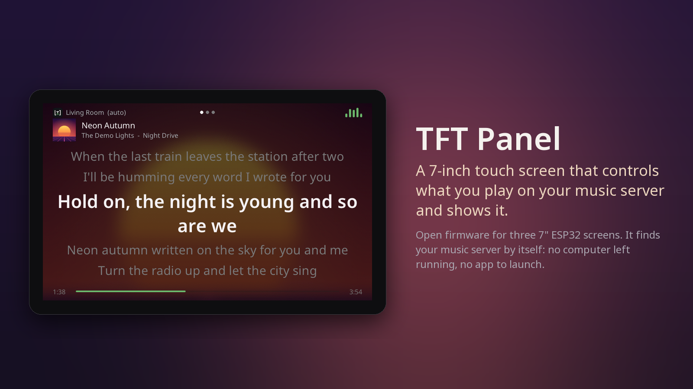
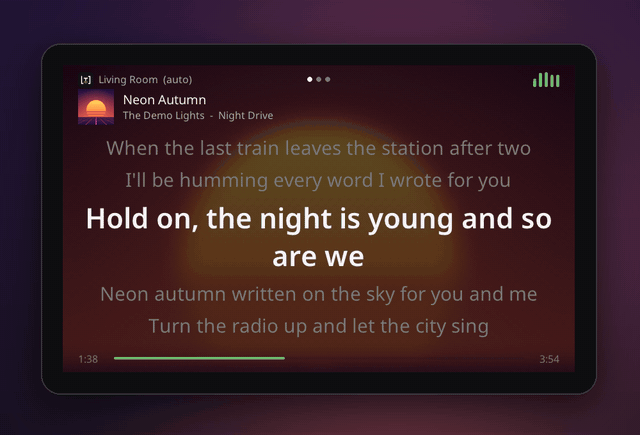

# TFT Panel

[](https://github.com/r45635/tft-panel/actions/workflows/build.yml)
[](LICENSE)

**A 7" touch screen that controls what you play on your music server and shows it — always on, with nothing
else to run.**



TFT Panel is open firmware for 7" ESP32 touch screens — the **Elecrow CrowPanel 7.0"**, the
**Waveshare ESP32-P4 7B** and the **VIEWE ESP32-P4 7"** (see [Hardware](#hardware)). Give it your
Wi-Fi and it finds your music server by itself. Then it is a remote you never have to unlock: the
cover and the title of what is playing, the lyrics in time with the song, play/pause, skip, a
volume slider and the choice of zone under your finger, and your whole library to search and start
from the screen. When the music stops it becomes a clock, with the weather and the day's headlines
if you want them.

No computer left running, no app to launch, no account, no cloud. It talks only to machines on
your own network.

<p align="center">
  <br>
  <em>At home, on the rack, beside the network player it follows. The lyrics are blurred: they are not ours to publish.</em>
</p>

> 🚧 **Early development** — it runs every day on the developer's panels, but expect rough edges.
> See [docs/ROADMAP.md](docs/ROADMAP.md).

- Three 7" boards, one firmware, flashed from your browser ([Install](#install)).
- Everything that has to be typed is on the panel's own page, not in a config file.
- Updates arrive over the air and roll back by themselves if one fails to start.
- MIT licence ([details](#licence)).

*Roon is a trademark of Roon Labs. TFT Panel is an independent project, not affiliated with Roon Labs, Elecrow, Waveshare or VIEWE.*

<p align="center"></p>

*Pictures from the panel's showcase mode: the song, lyrics, zones and cover are invented.*

## Where the lyrics come from

Roon serves none of its own, so the words are the one thing the panel is told where to find. Three
steps, one action each — stop at the one you want:

| | You do | You get |
|---|---|---|
| **1** | Flash the panel and give it your Wi-Fi | The remote, the cover, the clock. No lyrics yet |
| **2** | Run one container anywhere on your network: the [TextFromTrack companion](https://github.com/r45635/roon.app.textfromtrack.com) with `ROON_ENABLED=false` | The lyrics. The panel finds it by itself, and there is nothing to enable in Roon |
| **3** | Mount your music folder in that same container | *Your* lyrics: the `.lrc` files beside your files, the words in your tags, sources ranked against each other, a way to replace the wrong ones, a per-song offset |

Step 2 is a lyrics server and nothing else: it never pairs with Roon. It looks up
[LRCLIB](https://lrclib.net) for you, keeps what it finds, and can ask your own mirror first.

Two shortcuts, on the panel's page: point it straight at any **LRCLIB-compatible server** if you
would rather run nothing (one address to type — the public lrclib.net, or your mirror), or set the
lyrics to **none** if you came for the controls and the cover.

The companion can also give the panel what is playing, instead of the music server — that is the
other mode, and the panel asks nothing of Roon then.

## Hardware

| | Elecrow CrowPanel 7.0" | Waveshare ESP32-P4 7B | VIEWE ESP32-P4 7" |
|---|---|---|---|
| Model | ESP32 Display 7.0", SKU **DIS08070H**, board **V3.0** | **ESP32-P4-WIFI6-Touch-LCD-7B** | **UEP4S070H1024V600C-WB-C** |
| Chip | ESP32-S3 (4 MB flash, 8 MB PSRAM) | ESP32-P4 (32 MB flash, 32 MB PSRAM) + ESP32-C6 for Wi-Fi | ESP32-P4 (16 MB flash, 32 MB PSRAM) + ESP32-C6 for Wi-Fi |
| Screen | 800×480 RGB, GT911 touch | 1024×600 MIPI-DSI, GT911 touch | 1024×600 MIPI-DSI (JD9165), GT911 touch |
| Build | `pio run -e crowpanel7` | `pio run -e waveshare-p4-7b` | `pio run -e p4-s070-wba` |

The interface is drawn on an 800×480 grid and scaled to the screen, so all three look the same.

All three install from the browser. The installer asks **which screen you have** rather than guessing:
it only sees the chip, and both ESP32-P4 boards answer to the same one, so guessing would hand one of
them the other's firmware and leave it dark. Each board has its own manifest and its own files in every
release, and every panel updates over the air afterwards.

**Other screens are not supported**, even with the same chip and the same LCD controller: the
Guition JC1060P470C has the JD9165 of the VIEWE board and a different pin map, and the VIEWE bring-up
showed that sharing a controller is not sharing a configuration. Adding a board takes a new pin header
and **someone with the board to test it**: see [Other boards](docs/HARDWARE.md#other-boards).
Details, pin maps and pitfalls: [docs/HARDWARE.md](docs/HARDWARE.md).

## Install

**Before the first flash, save what is on the board.** Whatever it came with is overwritten and
cannot be downloaded again: `tools/backup-firmware.py --port /dev/cu.usbserial-XXXX` copies the
whole flash, writes its `sha256`, and reads the flash back to check the copy against the board —
and tells you plainly if the copy is not good. It also names the board, which is the one thing the
browser installer cannot do for the two ESP32-P4 screens.

**First time — from your browser, no tools to install.** Open the
[web installer](https://r45635.github.io/tft-panel/install.html) in Chrome or Edge on a computer, connect the
panel's USB-C port (on the Waveshare, the one marked *USB 1.1*), click *Install* and pick the serial
port; the installer picks the firmware for the screen it finds. On Windows the CrowPanel may need the
[CH340 driver](https://www.wch-ic.com/downloads/CH341SER_EXE.html).

**After that — over the air.** The panel checks for new releases by itself; when one is out, *Update*
appears at the top of the screen. Tap it and confirm: the panel downloads it, checks its sha256
against the one published with the release, and restarts. Nothing needs backing up first — the
version you are running stays in the other half of the flash, and the panel returns to it by itself
if the new one never starts properly. A firmware uploaded by hand from the panel's own page can
carry that same sha256, and is refused if it does not match.

## Build and flash

Requires [PlatformIO](https://platformio.org/) (VS Code extension or `pio` CLI). The toolchain is
pinned in `platformio.ini` (pioarduino = Arduino-ESP32 3.3 on ESP-IDF 5.5).

```bash
pio run -e crowpanel7 -t upload           # CrowPanel: flash over USB-C (CH340, 460800 baud)
pio run -e waveshare-p4-7b -t upload      # Waveshare: flash over USB-C "USB 1.1" (native USB)
pio run -e p4-s070-wba -t upload          # VIEWE: flash over USB-C (CH340, 230400 baud)
pio device monitor                        # serial log and console, 115200
```

## First start

Half a minute, screen by screen, with a film of it:
[the user guide's walkthrough](docs/USER_GUIDE.md#2-the-first-start-screen-by-screen).

With no Wi-Fi configured, the panel opens its own network `TFT-Panel-XXXX` and shows two QR codes:
scan the first to join it, the second to open the setup page, then pick your Wi-Fi. You can also pick
the network and type its password on the panel itself.

Once it is on your network the panel looks for your music server by itself, and for a TextFromTrack
companion if you run one. Everything that has to be typed — where the music comes from, the lyrics
server, the weather town, a news feed — is on the panel's own page at `http://tft-panel-xxxx.local`,
which its settings screen shows as a QR code. The
page names the panel, its board, its address and its firmware, so several panels are told apart; a
change asks once for the six digits shown on that panel's screen, then remembers your browser.

## Documentation

- [User guide](docs/USER_GUIDE.md) — install, Wi-Fi setup, screens, gestures, settings, updates
- [Architecture](docs/ARCHITECTURE.md) — how the panel talks to the companion, firmware layers, technical choices
- [Hardware](docs/HARDWARE.md) — pin map, bring-up log, pitfalls
- [Hardware test](docs/HARDWARE_TEST.md) — the checklist a maintainer runs on each board to validate a change
- [Roadmap](docs/ROADMAP.md)
- [Releasing](docs/RELEASING.md) — how a version is published (GitHub release + web installer)
- [Media kit](https://r45635.github.io/tft-panel/media-kit.html) — logos, pictures, video and texts for coverage

## Licence

TFT Panel is released under the [MIT licence](LICENSE) — code, documentation and media. The
firmware also contains third-party components under their own licences (Arduino core for ESP32:
LGPL-2.1; ESP-IDF: Apache-2.0; LVGL, ArduinoJson: MIT; Noto Sans: OFL 1.1): see
[THIRD_PARTY_NOTICES.md](THIRD_PARTY_NOTICES.md).
