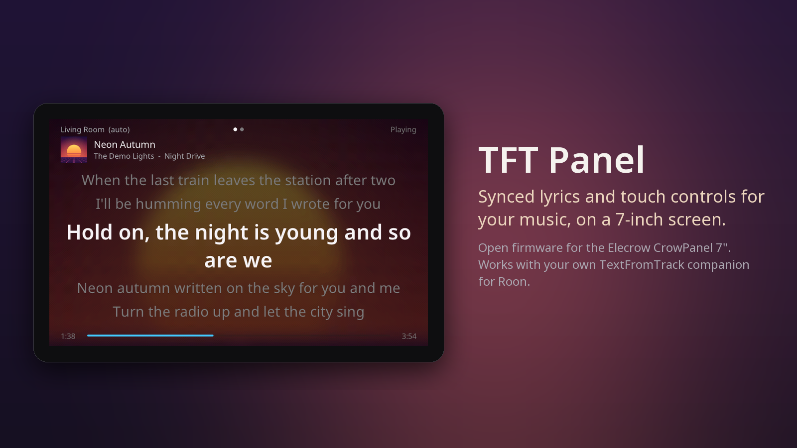
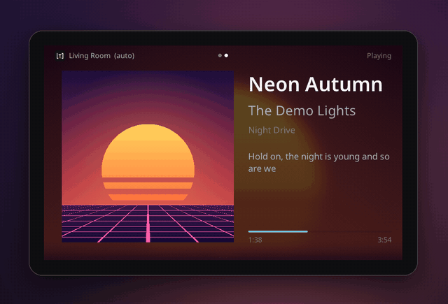

# TFT Panel

**A 7" touch screen that shows the synced lyrics of what you play in Roon — and lets you control it.**



TFT Panel is open firmware for the **Elecrow CrowPanel ESP32 Display 7.0"** (ESP32-S3, 800×480).
It is a companion screen for the
[TextFromTrack Roon Companion](https://github.com/r45635/roon.app.textfromtrack.com): the companion
watches your Roon Core and finds the lyrics; the panel displays them line by line, with the cover,
and gives you play/pause, skip, volume and zone selection at a touch.

> 🚧 **Early development** — synced lyrics, cover view, touch controls and over-the-air updates work
> on the developer's panel; expect rough edges. See [docs/ROADMAP.md](docs/ROADMAP.md).

- Talks only to **your own** companion on your LAN — no cloud, no account, no lyrics stored on the device.
- Same open HTTP API as the companion's web player.
- MIT licence.

*Roon is a trademark of Roon Labs. TFT Panel is an independent project, not affiliated with Roon Labs or Elecrow.*

<p align="center"></p>

*Pictures from the panel's showcase mode: the song, lyrics, zones and cover are invented.*

## Hardware

| | |
|---|---|
| Board | Elecrow CrowPanel ESP32 Display 7.0", SKU **DIS08070H**, board **V3.0** |
| MCU | ESP32-S3-WROOM-1-N4R8 (4 MB flash, 8 MB PSRAM) |
| Screen | 800×480 RGB, GT911 capacitive touch |

Details and pitfalls: [docs/HARDWARE.md](docs/HARDWARE.md).

## Install

**First time — from your browser, no tools to install.** Open the
[web installer](https://r45635.github.io/tft-panel/) in Chrome or Edge on a computer, connect the
panel's USB-C port, click *Install* and pick the serial port (about 3 minutes). On Windows you may
need the [CH340 driver](https://www.wch-ic.com/downloads/CH341SER_EXE.html).

**After that — over the air.** The panel checks for new releases by itself; when one is out, *Update*
appears at the top of the screen. Tap it and confirm: the panel downloads it, checks its checksum and
restarts. If the new version does not start properly, it goes back to the previous one by itself.

## Build and flash

Requires [PlatformIO](https://platformio.org/) (VS Code extension or `pio` CLI). The toolchain is
pinned in `platformio.ini` (pioarduino = Arduino-ESP32 3.3 on ESP-IDF 5.5).

```bash
pio run                                   # build
pio run -t upload                         # flash over USB-C (CH340, 460800 baud)
pio device monitor                        # serial log, 115200
```

## First start

With no Wi-Fi configured, the panel opens its own network `TFT-Panel-XXXX` and shows two QR codes:
scan the first to join it, the second to open the setup page, then pick your Wi-Fi. The companion is
found automatically on your network (Bonjour); its address and access token can also be entered there.

## Documentation

- [User guide](docs/USER_GUIDE.md) — install, Wi-Fi setup, screens, gestures, settings, updates
- [Architecture](docs/ARCHITECTURE.md) — how the panel talks to the companion, firmware layers, technical choices
- [Hardware](docs/HARDWARE.md) — pin map, bring-up log, pitfalls
- [Roadmap](docs/ROADMAP.md)
- [Releasing](docs/RELEASING.md) — how a version is published (GitHub release + web installer)
