# TFT Panel — user guide

TFT Panel turns a 7" touch screen (Elecrow CrowPanel 7", Waveshare ESP32-P4 7B or VIEWE ESP32-P4 7")
into a remote for the music you play on your music server, and a screen that shows it: pause, skip, change the
volume, pick the zone, search your library and start an album, all with a touch — while the cover
and the words of the song scroll in time with the music.

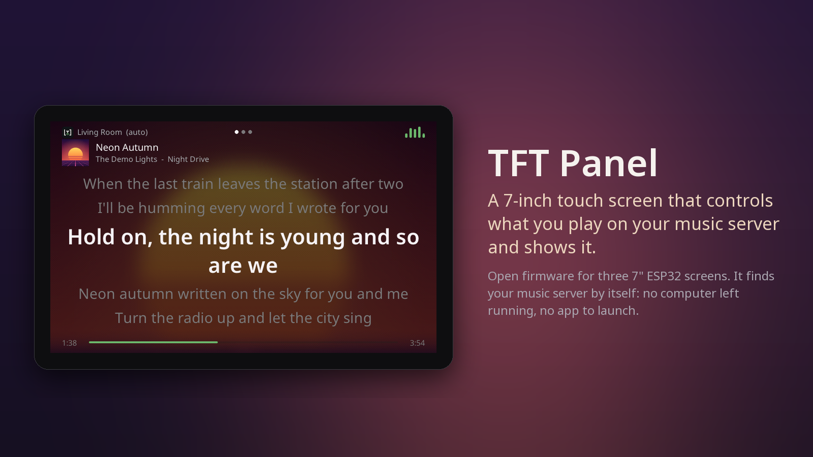

*All pictures in this guide come from the panel itself, in its showcase mode: the song, lyrics,
zones and cover are invented.*

## What you need

- One of these screens, and a USB-C cable that carries data:
  - **Elecrow CrowPanel ESP32 Display 7.0"** (DIS08070H), board **V3.0**;
  - **Waveshare ESP32-P4-WIFI6-Touch-LCD-7B** (1024×600);
  - **VIEWE ESP32-P4 7"** (UEP4S070H1024V600C-WB-C, 1024×600).

  Other screens are not supported, even look-alikes with the same ESP32-P4 chip and the same display
  controller (for example the Guition JC1060P470C): their display needs different settings, and the
  installer would give them the Waveshare firmware. Their screen would stay dark.
- A **Roon** system. The panel can get what is playing in either of two ways:
  - **straight from your music server**, with nothing else running. You enable *TFT Panel* once in
    Roon's Settings → Extensions and it is done; lyrics then come from an LRCLIB-compatible server
    you give it (the public lrclib.net, or your own mirror), or from a companion if you run one;
  - from the free **TextFromTrack companion** on a computer of the same network, which also finds,
    ranks and lets you correct the lyrics. Several passages below assume it, because it is where
    the lyrics are managed rather than merely looked up.
- Your **Wi-Fi** network name and password (2.4 GHz).

## 1. Install the firmware (once)

### Before you flash: save what is on the board

Whatever your screen came with — a vendor demo, another firmware — is **overwritten and cannot be
downloaded again from anywhere**. Saving it first takes one command and a few minutes:

```bash
tools/backup-firmware.py --port /dev/cu.usbserial-XXXX     # Windows: COM5
```

It says what the board is and which image it takes, copies the whole flash to
`~/tft-panel-backups/`, writes the copy's `sha256` beside it, **and then reads the flash back to
check the copy against the board**. If anything is short or different it tells you there is no
backup rather than leaving you a file that looks like one. Nothing is written to the board.

One day, to put it back: `tools/backup-firmware.py --port … --restore <the .bin>`. That restores
the settings too — a restored panel rejoins your Wi-Fi and finds its music server with nothing to
set up again, because the copy holds the panel's whole memory. Which is also why the file deserves
the same care as a password, and should never be attached to a bug report.

It is also the only thing that tells the two ESP32-P4 boards apart before you flash them — the
browser installer sees one chip for both, and the wrong image leaves the screen dark. If you
already flashed and the screen stayed black, plug in the USB cable and read the serial console
(`pio device monitor`): the firmware says **WRONG BOARD** and names the image you need.

### Flash it

1. On a computer, open the [web installer](https://r45635.github.io/tft-panel/install.html) in **Chrome or Edge**.
2. **Say which screen you have.** The page asks, because it only sees the chip and two of the three
   boards answer to the same one — picking for you would risk leaving a panel dark.
3. Connect the panel with the USB-C cable — on the Waveshare, the port marked **USB 1.1** — click
   **Connect** and pick the serial port. The dialog then offers **Install**, and names the screen you
   chose, so you can check it one last time. It takes about 3 minutes on the CrowPanel, about a
   minute on the ESP32-P4 boards.
   - CrowPanel and VIEWE: the port is called *USB Serial*, *CH340* or *usbserial*.
   - Waveshare: *USB JTAG/serial debug unit* or *usbmodem*.
4. CrowPanel or VIEWE on Windows: if no port shows up, install the
   [CH340 driver](https://www.wch-ic.com/downloads/CH341SER_EXE.html) and plug the panel again.

After this, updates come over Wi-Fi (see [Updates](#updates)).

## 2. The first start, screen by screen

Half a minute, from the screen you meet when you plug it in to the clock it settles on. Nothing
here is typed except your Wi-Fi password.

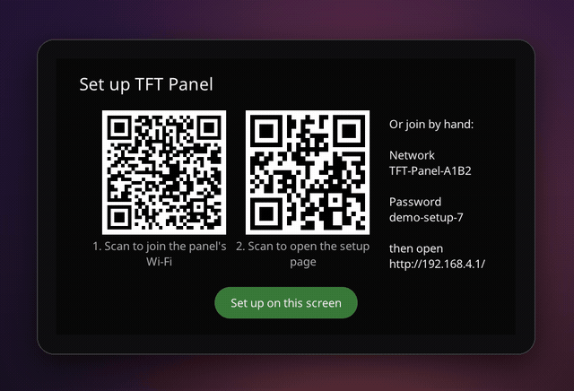

*Better quality: [first-start.mp4](media/first-start.mp4). The song, the networks and the password
in the picture are invented.*

| | What you see | What to do |
|---|---|---|
| 1 | **Set up TFT Panel**, two QR codes | Tap **Set up on this screen**, or scan the codes with a phone |
| 2 | **Choose your Wi-Fi** | Tap your network |
| 3 | A keyboard | Type the password, **Connect** |
| 4 | **Looking for your music server…** | Nothing. It is searching; this is the normal wait |
| 5 | The song, its words in time with it | Swipe for the cover, swipe again for the clock |

If step 4 never ends, the panel is on your network but nothing answered: see
[Troubleshooting](#troubleshooting). If the screen stays dark from the start, it is not the Wi-Fi —
it is the wrong firmware for your board, and the USB serial console says **WRONG BOARD** with the
image you need.

## 3. Connect it to your Wi-Fi, in detail

On its first start the panel shows two QR codes and a button. Two ways to go on:

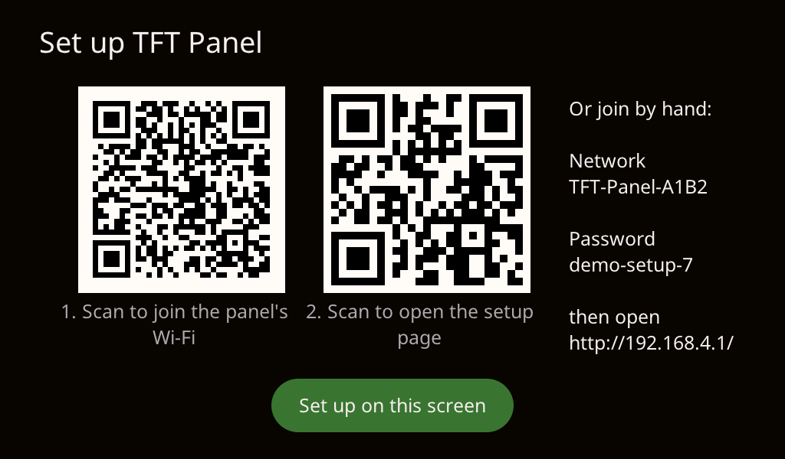

**On the panel itself** — tap **Set up on this screen**. The panel lists the Wi-Fi networks it
hears, strongest first; tap yours, type its password on the keyboard (**Show** reveals it) and tap
**Connect**. An open network needs no password.

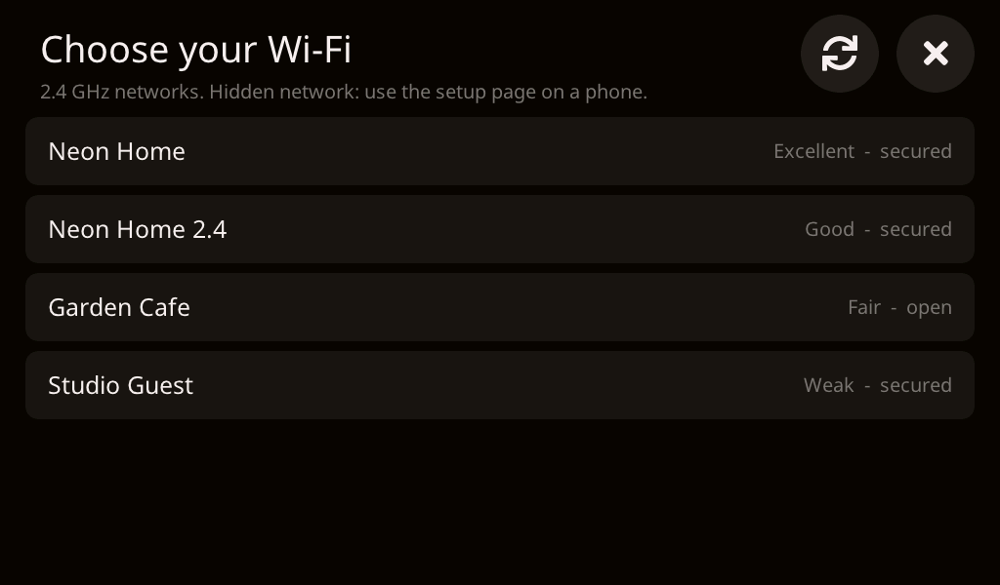

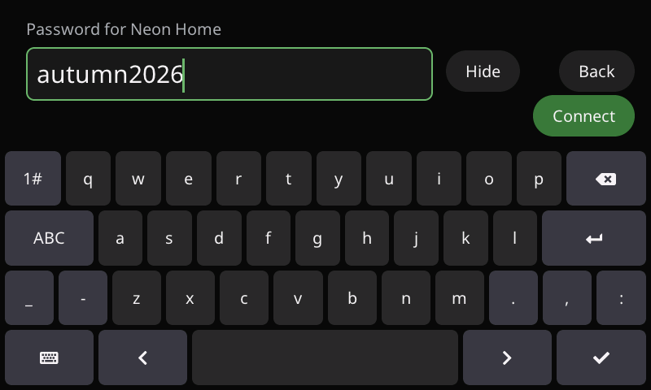

**With a phone** — useful for a hidden network, or to enter the companion's address:

1. Scan the **first** code with your phone: it joins the panel's own network.
2. Scan the **second** one: the setup page opens and lists the networks the panel hears. Tap
   yours, type its password, **Save**. A network that is not listed can be typed by hand.

The panel restarts, joins your network and looks for a music server — this is what it shows while
it does, and it is nothing to worry about for the first few seconds:


It finds the companion by itself. Only 2.4 GHz networks
work (most routers offer both). To move the panel to another network later: **Settings > Wi-Fi >
Change...**. If the companion is
on another network segment, its address (and its access token, if you set one) can be typed on
the same setup page.

## 4. Lyrics and cover

Roon serves no lyrics of its own, so the panel is told where to find them, on
[its own page](#8-the-panels-own-page). Either run the **TextFromTrack companion** anywhere on your
network — one container, `ROON_ENABLED=false`, nothing to enable in Roon, and the panel finds it by
itself — or type the address of any **LRCLIB-compatible server** (the public lrclib.net, or your own
mirror). Set it to *none* if you came for the controls and the cover. The companion is also what
gives you *your* lyrics: the `.lrc` files beside your music, the words in your tags, the wrong ones
replaced, a per-song offset that is remembered.

The panel follows the zone that is playing. The current line is large, the lines around it
dimmed; they slide up as the song goes.

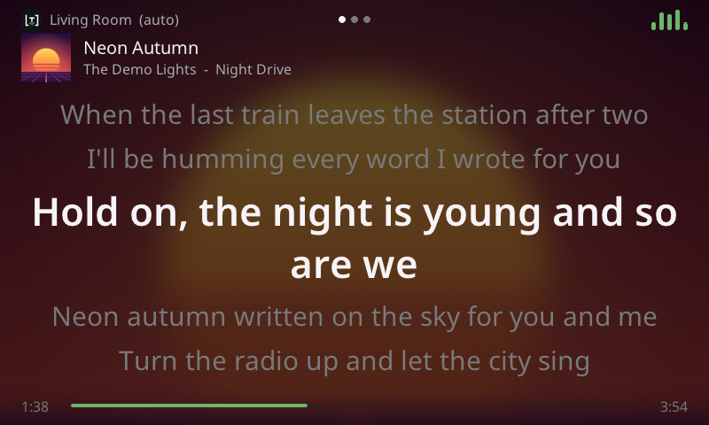

**Swipe left or right** to switch to the cover view, and back. The panel remembers your choice.
A song without lyrics shows the cover view by itself, and returns to the lyrics as soon as
there are some.

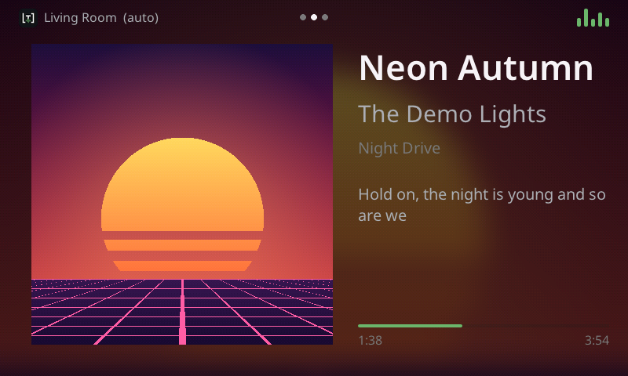

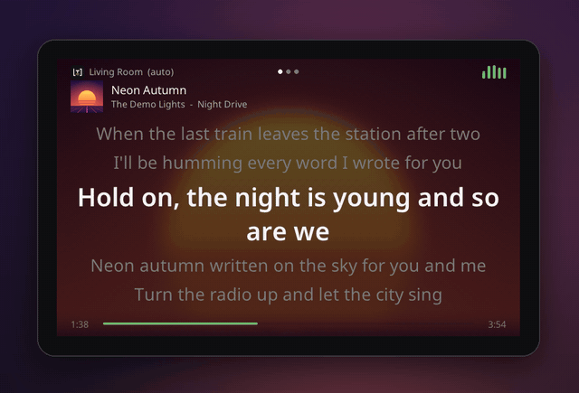

## 5. Controls

**Tap** the screen to show the controls (they hide after a few seconds): zone, previous,
play/pause, next, volume − / +, settings.

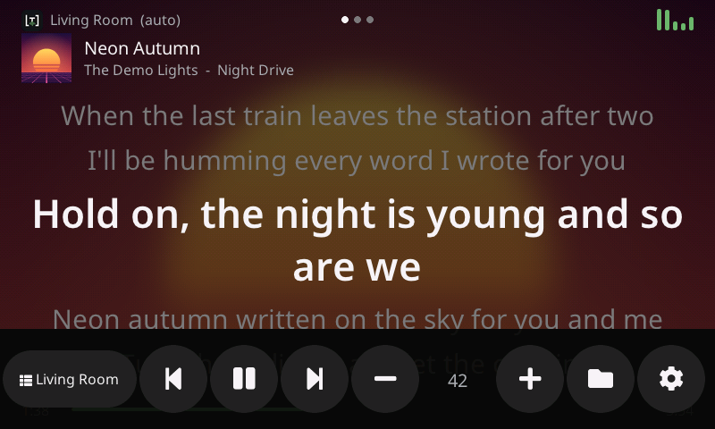

- **Zone**: follow the playing zone (*auto*), or stay on one zone.

  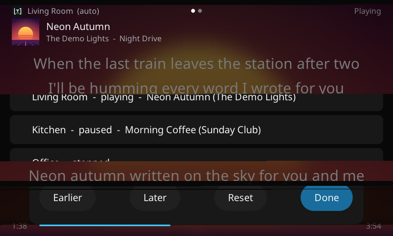

- **Volume**: tap the number between − and + for a slider and **Mute**.

  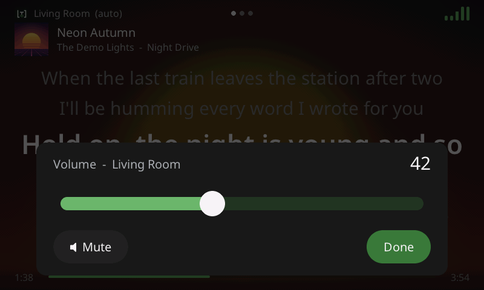

- **Lyrics timing**: if the lyrics run early or late for a song, **press and hold** the lyrics,
  then *Earlier* / *Later* (by 0.25 s) or *Reset*. It is saved for that song.

  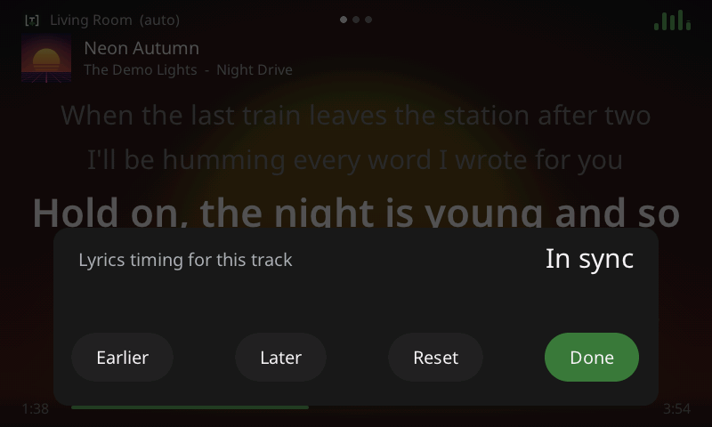

## Find music

The controls bar has a **folder** button: the music library (on all three screens; on the
CrowPanel since v0.1.17).

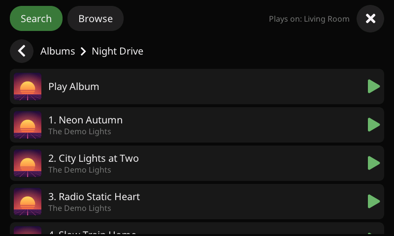

- **Search**: the green cursor blinks in the field; type an artist, album or track on the
  keyboard, then **Search**. The results come
  by kind (artists, albums, tracks…); tap one to open it.
- **Browse**: Roon's own menus — Library (artists, albums, tracks, composers, tags), playlists,
  radio, genres.
- **◀** goes back one level; **Show more** loads the rest of a long list.
- A row with a green **▶** can be played: tap it and choose **Play Now**, **Add Next**,
  **Queue** or **Start Radio**. It plays on the zone shown at the top right (*Plays on: …*),
  the one the panel follows; pick another zone with the zone button first.

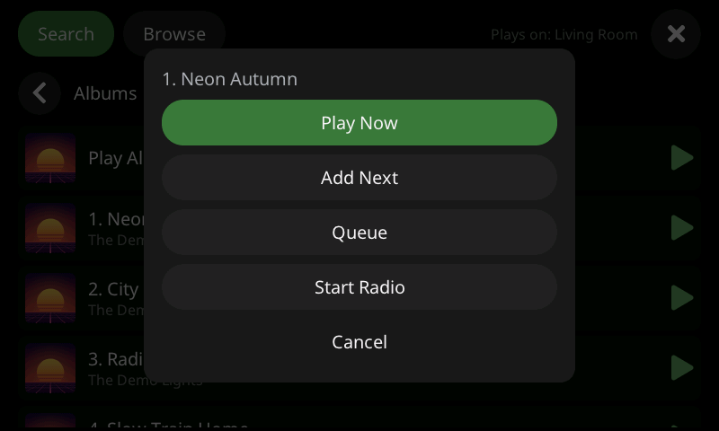

Browsing from the panel does not move what Roon's other apps or the companion's web player are
showing.

### From what is playing

On the **cover view**, the artist and the album under the title are tappable: the artist opens
that artist's albums, the album opens its track list, ready to play. When the name is not exactly
one thing in your library — several artists on a track, an album title shared by other records —
the panel shows what it found and lets you choose rather than opening a guess.

## 6. Settings

The gear button opens the settings: brightness, colour warmth, when the screen turns off, how
far ahead the lyrics show, the blurred cover background, smooth scrolling, the idle clock and its
time zone, the zone, forgetting the Wi-Fi, the firmware version and updates.

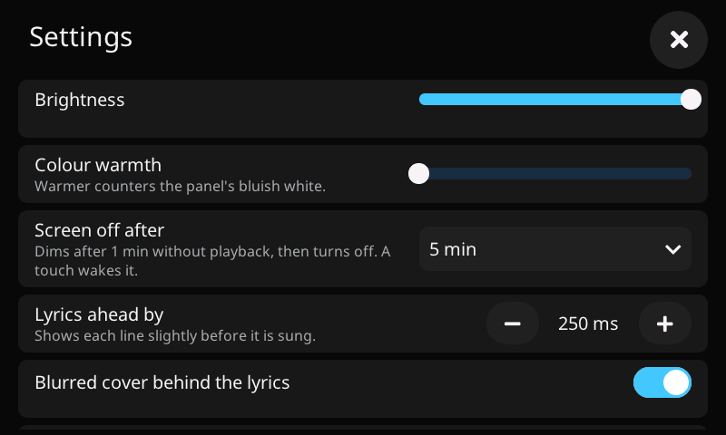

**Colour warmth**: this panel's white is bluish. *Colour test* shows white, greys and colours
with a live slider: move it until the white looks neutral to you.

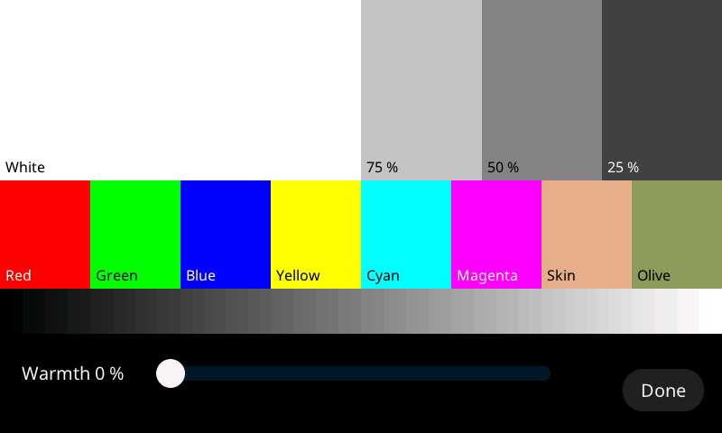

## 7. The clock, the weather and the news

The clock is both an idle screen and a view of its own: swipe to it like the lyrics and the cover.
After a minute without music the panel shows it by itself, dims, and turns the screen off after the
delay chosen in the settings. A touch, or music starting, wakes it.

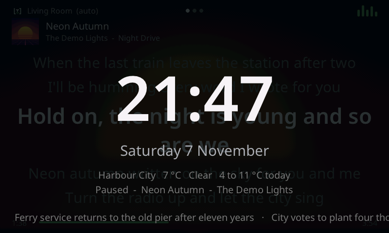

Give it a **town** and it shows the temperature, the sky and today's range beside the time. Towns
share their names, so add what tells yours apart: `Montreal, Canada`, `Paris, Texas`,
`Lyon, France`. The page says which town it settled on, with its coordinates, and says so plainly
when it cannot find the one you meant.

The title under the date is the track the panel is following, which may well have finished hours
ago. So that you can tell one from the other at a glance, **five small bars dance in the top right
corner while music is playing** and disappear when it stops — the lyrics and cover views have their
progress bar for that, the clock had nothing.

Give it the address of an **RSS or Atom feed** and the headlines slide under the clock at reading
pace. Both are typed on the panel's page, below. If nothing slides, the page says why, under the
field: the feed did not answer, or the address holds a web page rather than a feed.

## 8. The panel's own page

Everything that has to be typed lives on one page, in any browser on your network:
`http://tft-panel-xxxx.local` — the settings screen shows it as a QR code, and its name, board,
address and firmware are written at the top, so two panels are never confused. The QR closes
itself as soon as the page asks for the code, which is shown on the same screen it was covering.

It carries where the music comes from, the companion's address and token, the lyrics server and its
token, the weather town and the news feed.

Changing something asks once for the **six digits shown on that panel's screen**: being on the
network is not enough, you have to be in front of it. After that the panel remembers your browser
for a month, so later changes are two taps; *Forget this browser* on the page undoes that, and so
does forgetting the Wi-Fi or erasing the panel. A firmware upload always asks for a fresh code.

## Updates


The panel looks for a new version every day. When there is one, **Update** appears at the top:

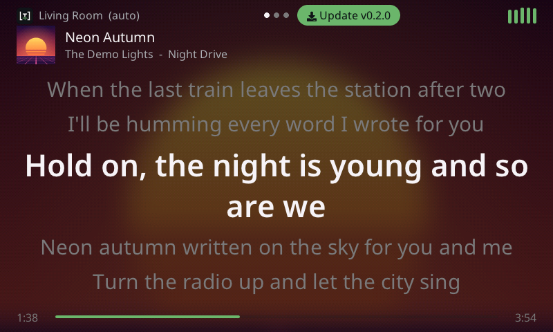

Tap it and confirm. The panel downloads the update, **checks its sha256 against the one published
with the release** and refuses it if a single byte differs, then restarts (about a minute).
Don't unplug it meanwhile — the screen says so, and shows how far it has got. There is nothing to
back up first: the version you are running stays in the other half of the flash, and the panel
returns to it by itself if the new one never starts properly.

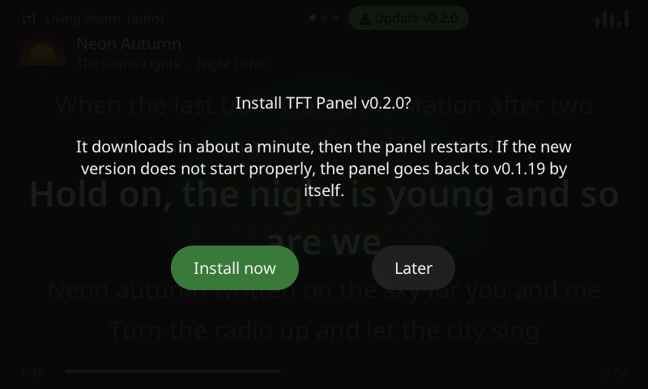 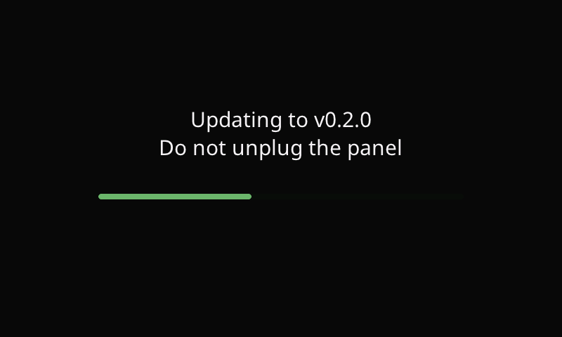

### From a computer instead

Open `http://tft-panel-xxxx.local/update` (the name is shown in the settings, under *About*),
choose a firmware file, and type the 6-digit code the panel shows:

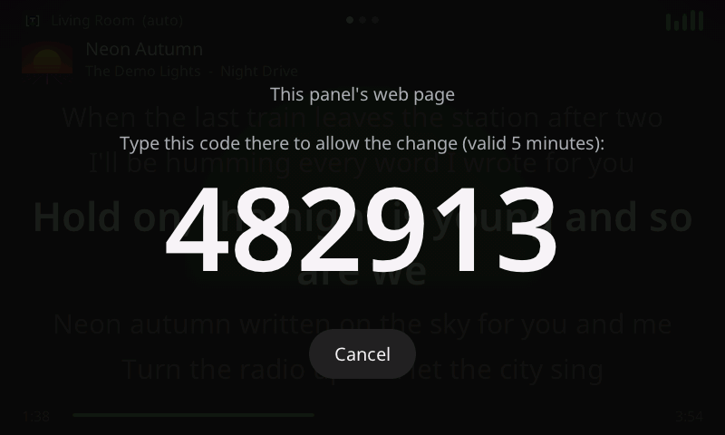

Beside the file there is a box for the **sha256** published with each release, in the
`…-vX.Y.Z.sha256` file next to the firmware. Paste it and the panel refuses the upload unless
every byte matches, naming both digests so you can see which file you actually have. Leave it
empty and the panel still tells you the digest of what it received, so you can compare afterwards.

The panel shows the same *Updating… do not unplug* picture as it does for an update of its own,
from the first byte to the last, so you can see it working from across the room. If it refuses the
file, it says so on its screen too, and goes back to what it was doing.

A wrong code is used up the moment it is refused: read the new one on the screen, or reload the
page. And whatever happens here, the version you are replacing stays in the other half of the
flash until the new one has proved it starts.

## Troubleshooting

| You see | Do this |
|---|---|
| The setup QR codes come back | The panel cannot join your Wi-Fi for a minute: check the password, or that the network is 2.4 GHz. |
| "Looking for the TextFromTrack companion" | Start the companion on its computer; same network as the panel. If it runs on a laptop with a dock or a second network adapter, give the panel its address on the panel's page instead: a machine can announce an address that is not reachable from the panel. |
| "Enable TFT Panel in Roon" | Direct mode: open Roon → Settings → Extensions and enable it once. |
| The weather shows the wrong town | On the panel's page, add a region or country after the name (`Paris, Texas`). |
| The page says the code is wrong | The code on the screen changes every five minutes; read the new one. |
| "No lyrics found for this track" | The lyrics server found none; the cover view shows instead. |
| No lyrics at all, on every song | Nothing is set to look them up: on the panel's page, give a lyrics server, or run the companion on your network. The serial console says `no lyrics server`. |
| Lyrics early or late for one song | Press and hold the lyrics, adjust *Earlier* / *Later*. |
| Lyrics early or late for every song | Settings → *Lyrics ahead by*. |
| The screen looks bluish or yellowish | Settings → *Colour test*, move the warmth slider. |
