# TFT Panel — user guide

TFT Panel turns a 7" touch screen (Elecrow CrowPanel 7" or Waveshare ESP32-P4 7B) into a lyrics screen for the music you play with Roon:
the words of the song scroll in time with the music, with the cover, and you can pause, skip,
change the volume or the zone with a touch.

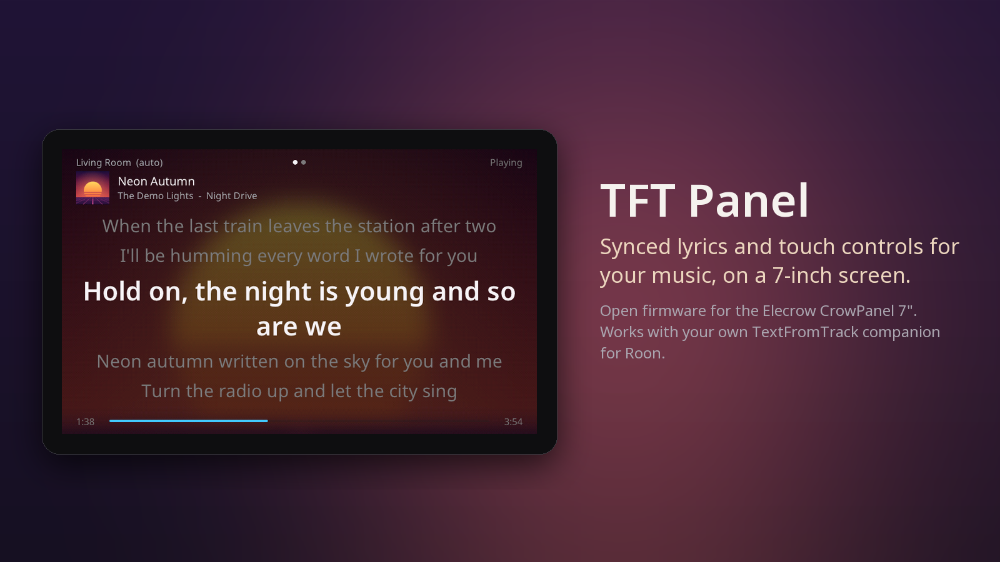

*All pictures in this guide come from the panel itself, in its showcase mode: the song, lyrics,
zones and cover are invented.*

## What you need

- One of these screens, and a USB-C cable that carries data:
  - **Elecrow CrowPanel ESP32 Display 7.0"** (DIS08070H), board **V3.0**;
  - **Waveshare ESP32-P4-WIFI6-Touch-LCD-7B** (1024×600).

  Other screens are not supported, even look-alikes with the same ESP32-P4 chip (for example the
  Guition JC1060P470C): their display needs different settings, and the installer would give them the
  Waveshare firmware. Their screen would stay dark.
- A **Roon** system, and the free **TextFromTrack companion** running on a computer of the same
  network: it finds the lyrics and tells the panel what plays.
- Your **Wi-Fi** network name and password (2.4 GHz).

## 1. Install the firmware (once)

1. On a computer, open the [web installer](https://r45635.github.io/tft-panel/install.html) in **Chrome or Edge**.
2. Connect the panel with the USB-C cable — on the Waveshare, the port marked **USB 1.1** — click
   **Install**, pick the serial port and confirm. The installer recognises the screen and picks its
   firmware. It takes about 3 minutes on the CrowPanel, about a minute on the Waveshare.
   - CrowPanel: the port is called *USB Serial*, *CH340* or *usbserial*.
   - Waveshare: *USB JTAG/serial debug unit* or *usbmodem*.
3. CrowPanel on Windows: if no port shows up, install the
   [CH340 driver](https://www.wch-ic.com/downloads/CH341SER_EXE.html) and plug the panel again.

After this, updates come over Wi-Fi (see [Updates](#updates)).

## 2. Connect it to your Wi-Fi

On its first start the panel shows two QR codes and a button. Two ways to go on:

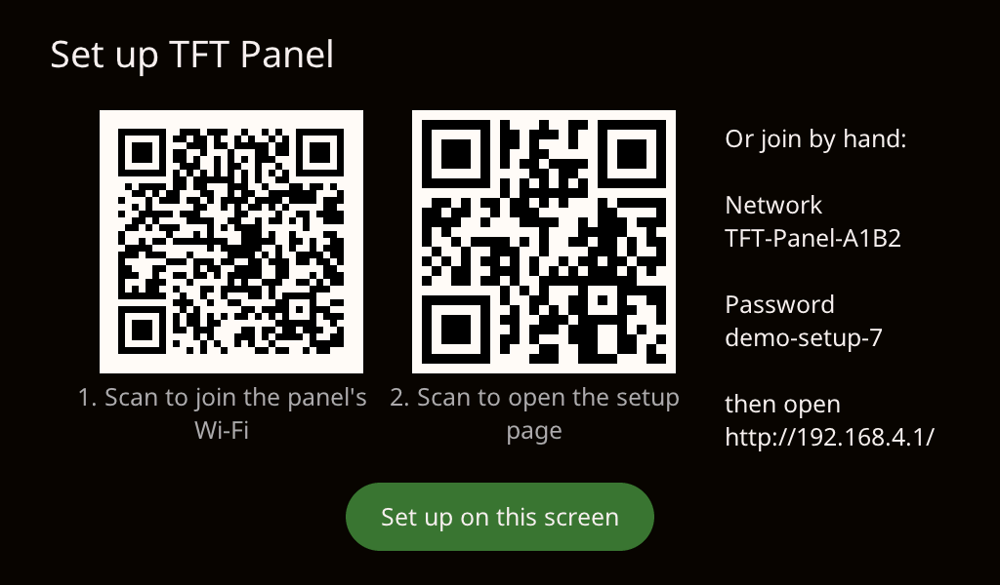

**On the panel itself** — tap **Set up on this screen**. The panel lists the Wi-Fi networks it
hears, strongest first; tap yours, type its password on the keyboard (**Show** reveals it) and tap
**Connect**. An open network needs no password.

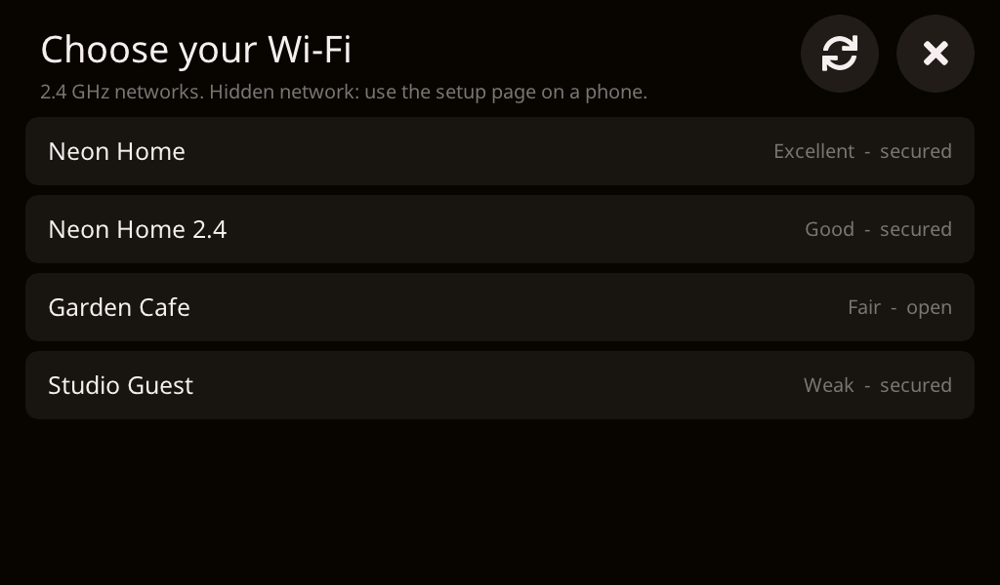

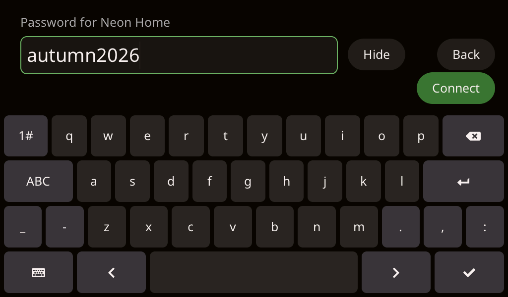

**With a phone** — useful for a hidden network, or to enter the companion's address:

1. Scan the **first** code with your phone: it joins the panel's own network.
2. Scan the **second** one: the setup page opens and lists the networks the panel hears. Tap
   yours, type its password, **Save**. A network that is not listed can be typed by hand.

The panel restarts, joins your network and finds the companion by itself. Only 2.4 GHz networks
work (most routers offer both). To move the panel to another network later: **Settings > Wi-Fi >
Change...**. If the companion is
on another network segment, its address (and its access token, if you set one) can be typed on
the same setup page.

## 3. Lyrics and cover

The panel follows the zone that is playing. The current line is large, the lines around it
dimmed; they slide up as the song goes.

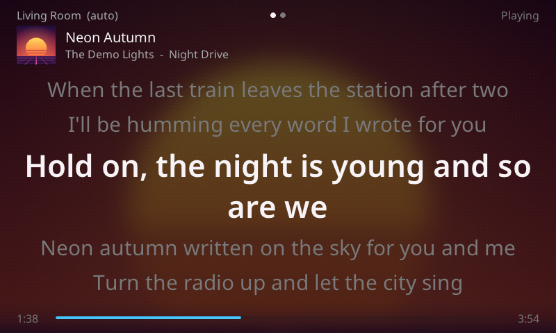

**Swipe left or right** to switch to the cover view, and back. The panel remembers your choice.
A song without lyrics shows the cover view by itself, and returns to the lyrics as soon as
there are some.

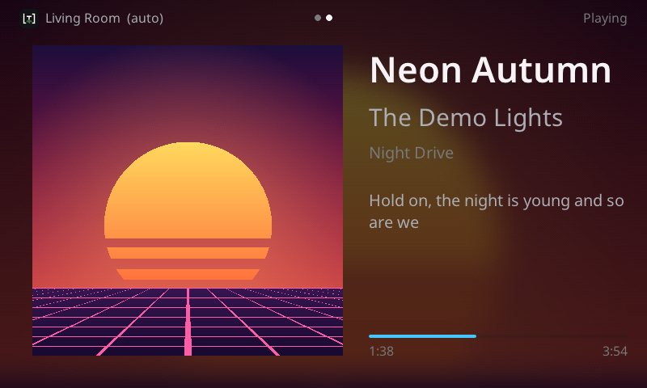

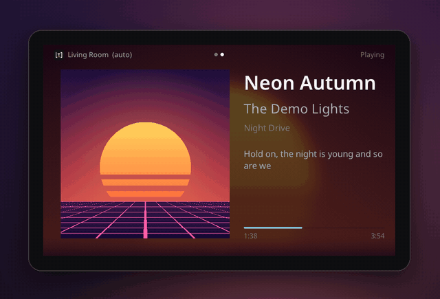

## 4. Controls

**Tap** the screen to show the controls (they hide after a few seconds): zone, previous,
play/pause, next, volume − / +, settings.

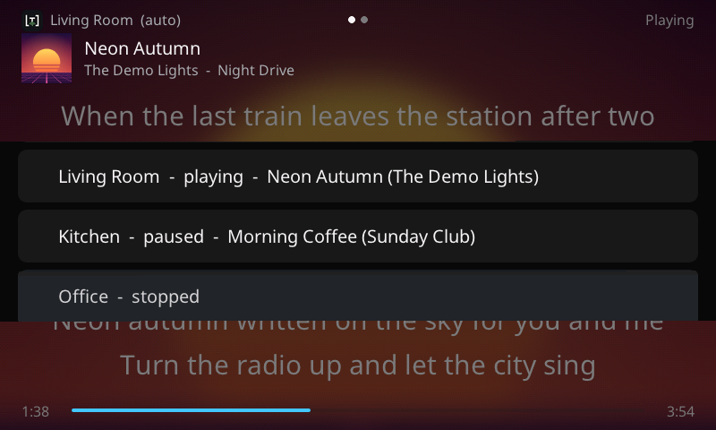

- **Zone**: follow the playing zone (*auto*), or stay on one zone.

  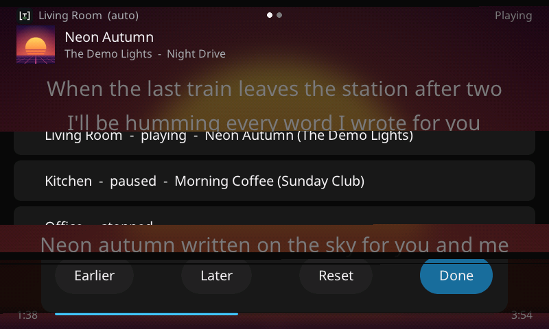

- **Volume**: tap the number between − and + for a slider and **Mute**.

  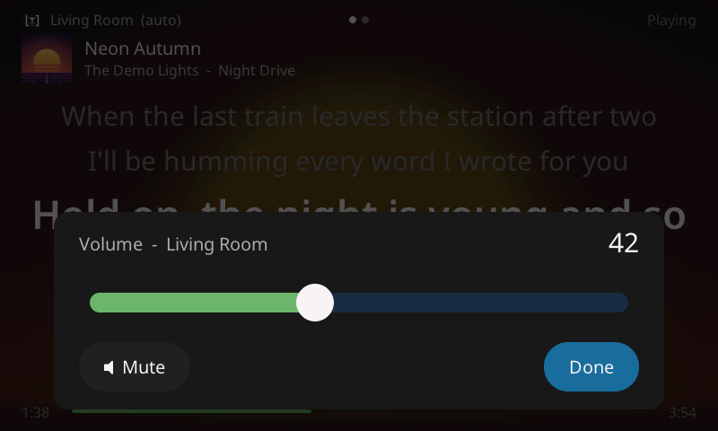

- **Lyrics timing**: if the lyrics run early or late for a song, **press and hold** the lyrics,
  then *Earlier* / *Later* (by 0.25 s) or *Reset*. It is saved for that song.

  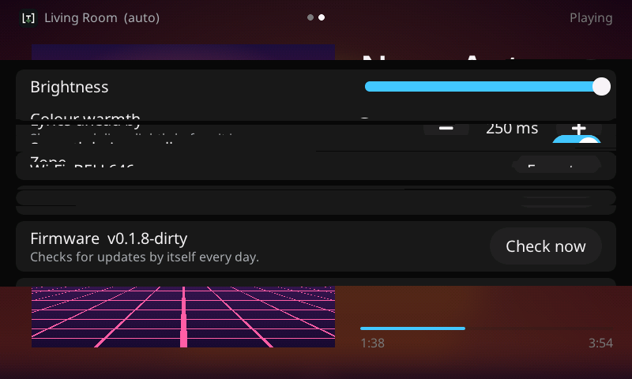

## Find music

The controls bar has a **folder** button: the music library (both screens, since v0.1.17 on the
CrowPanel).

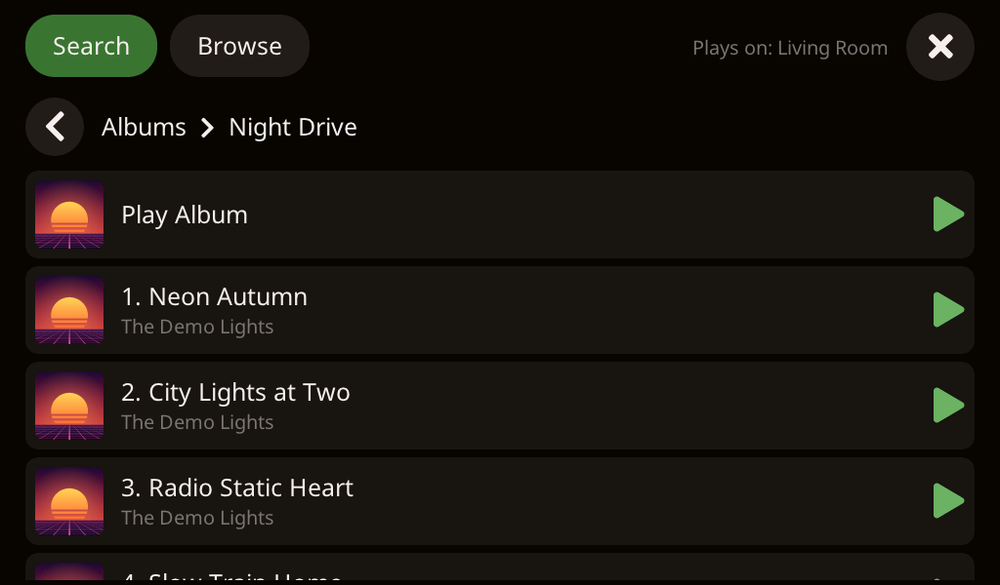

- **Search**: the green cursor blinks in the field; type an artist, album or track on the
  keyboard, then **Search**. The results come
  by kind (artists, albums, tracks…); tap one to open it.
- **Browse**: Roon's own menus — Library (artists, albums, tracks, composers, tags), playlists,
  radio, genres.
- **◀** goes back one level; **Show more** loads the rest of a long list.
- A row with a green **▶** can be played: tap it and choose **Play Now**, **Add Next**,
  **Queue** or **Start Radio**. It plays on the zone shown at the top right (*Plays on: …*),
  the one the panel follows; pick another zone with the zone button first.

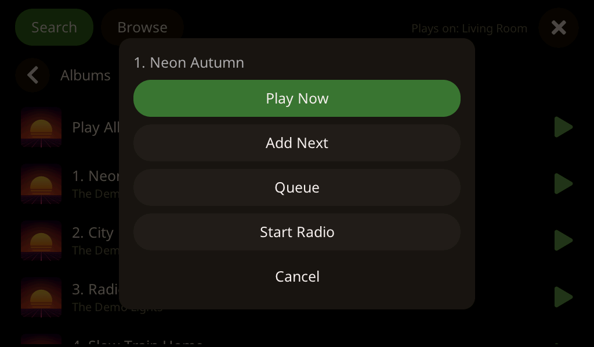

Browsing from the panel does not move what Roon's other apps or the companion's web player are
showing.

### From what is playing

On the **cover view**, the artist and the album under the title are tappable: the artist opens
that artist's albums, the album opens its track list, ready to play. When the name is not exactly
one thing in your library — several artists on a track, an album title shared by other records —
the panel shows what it found and lets you choose rather than opening a guess.

## 5. Settings

The gear button opens the settings: brightness, colour warmth, when the screen turns off, how
far ahead the lyrics show, the blurred cover background, smooth scrolling, the idle clock and its
time zone, the zone, forgetting the Wi-Fi, the firmware version and updates.

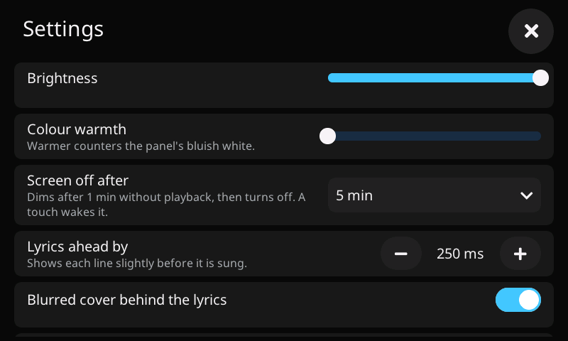

**Colour warmth**: this panel's white is bluish. *Colour test* shows white, greys and colours
with a live slider: move it until the white looks neutral to you.

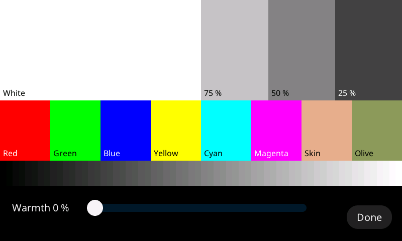

## 6. When nothing plays

After a minute without music the screen dims and shows a clock; it turns off after the delay
chosen in the settings. A touch, or music starting, wakes it.

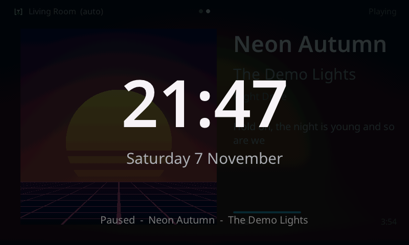

## Updates

The panel looks for a new version every day. When there is one, **Update** appears at the top:

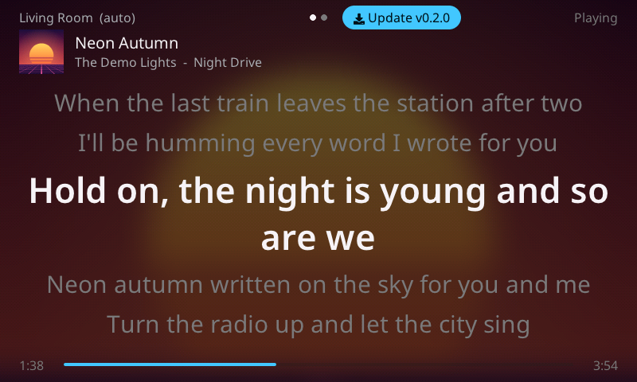

Tap it and confirm. The panel downloads the update, checks it, and restarts (about a minute).
Don't unplug it meanwhile. If the new version does not start properly, the panel goes back to
the previous one by itself.

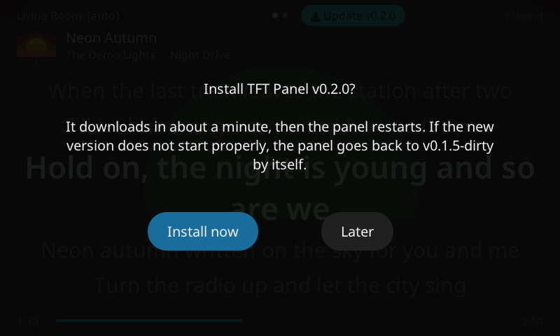 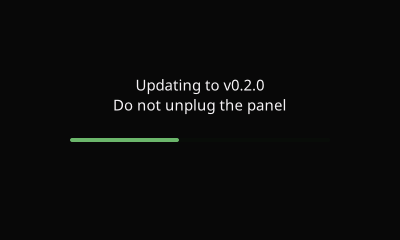

### From a computer instead

Open `http://tft-panel-xxxx.local/update` (the name is shown in the settings, under *About*),
choose a firmware file, and type the 6-digit code the panel shows:

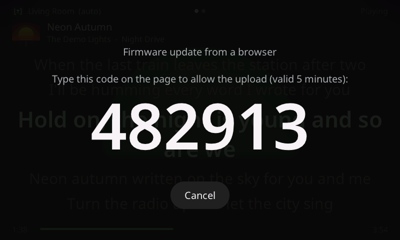

## Troubleshooting

| You see | Do this |
|---|---|
| The setup QR codes come back | The panel cannot join your Wi-Fi for a minute: check the password, or that the network is 2.4 GHz. |
| "Looking for the TextFromTrack companion" | Start the companion on its computer; same network as the panel. |
| "No lyrics found for this track" | The companion found none; the cover view shows instead. |
| Lyrics early or late for one song | Press and hold the lyrics, adjust *Earlier* / *Later*. |
| Lyrics early or late for every song | Settings → *Lyrics ahead by*. |
| The screen looks bluish or yellowish | Settings → *Colour test*, move the warmth slider. |
